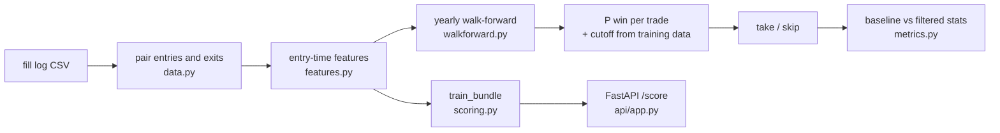

# Meta-Labeling Trade Filter

[](https://github.com/Avinash186200/meta-labeling-trade-filter/actions/workflows/ci.yml)  [](LICENSE)

A second-stage model that sits on top of an existing trading strategy, scores every trade at entry, and skips the weakest ones. The base strategy decides *what* to trade. This model only decides *whether to take it*.

I built this for a long-only trend strategy on a futures contract. The original trade log is proprietary, so it is not in this repo. Everything here runs on a **synthetic trade log that has exactly the same columns**, so you can clone the repo and reproduce every number below.

## What problem this solves

A trading strategy takes many trades, and some of them lose in ways you could have guessed at entry. This repo trains a model that looks at each trade just before it is placed and gives it a probability of winning. Low scores are skipped, so the strategy takes fewer, better trades. The hard part is doing this without letting the model see anything it could not have known at that moment.

## At a glance

| | |
|---|---|
| **Input** | Broker-style fill log: one Entry row and one Exit row per position (`Position_ID`, `Trade_Date`, `Trade_Time`, `Price`, `Take_Profit`, `Realized_PnL`, ...) |
| **Method** | Entry-time features from the trade's own structure and prior closed trades, then a yearly expanding walk-forward with LogReg, RandomForest and gradient boosting |
| **Output** | Out-of-sample P(win) per trade, a take/skip decision, baseline-vs-filtered statistics, and a deployable scoring bundle plus API |
| **Leakage controls** | T-1 strict history, a cutoff fixed from training data only, keep-fraction chosen in advance, and a noise test in CI |
| **Status** | Research complete. Results below are synthetic and illustrative only |

## How it works



1. **Pair** the Entry and Exit rows into one row per closed trade. Positions that are still open are dropped.
2. **Features** use only what was known before entry:
   - the take-profit distance
   - time of day, day of week and month
   - the gap from the last exit
   - the last trade's P&L and duration
   - rolling win rate and average P&L over 5, 10 and 20 trades, P&L volatility, and the current streak
3. **Walk-forward**, year by year: train on all earlier years and test on the next one. The first two years are warm-up only. Training trades must have closed before the test year starts.
4. **Filter**: keep the trades whose P(win) is at or above a cutoff. The cutoff is a quantile of the model's probabilities on the **training** data.
5. **Compare** the taken trades against "take everything" on the same calendar: win rate, Sharpe, max drawdown.
6. **Serve**: fit one bundle on the whole log and score new trades through a small API.

A step-by-step code walkthrough with real intermediate output is in [docs/walkthrough.md](docs/walkthrough.md).

## Key concepts

- **Primary model**: the existing strategy. It decides the direction and timing of each trade.
- **Meta-labeling**: a second model that predicts whether the primary model's trade will win, and is used to take or skip it.
- **Label**: `win = pnl > 0` for each closed trade.
- **Look-ahead leakage**: any feature, label or setting that uses information from after the decision time. It makes backtests look better than reality.
- **T-1 history**: features only use trades that closed on an earlier calendar day, as in a daily-upload workflow.
- **Expanding walk-forward**: train on all years before Y, test on year Y, then move one year forward.
- **Purge**: drop training trades whose outcome was not known yet when the test period started.
- **Keep-fraction**: the share of trades the filter aims to keep (0.75 here). It is fixed before running, not tuned on results.
- **Noise test**: run the same pipeline on data with no signal. A leak-free pipeline should find no edge.
- **Sharpe ratio**: mean daily return divided by its standard deviation, scaled by the square root of 252.
- **Max drawdown**: the worst fall from a previous equity peak.

## What you will learn

- How to turn a raw broker fill log into one clean row per trade.
- How to build features that only use information available at entry, and how to test that.
- How to run a yearly walk-forward with a purge at the fold boundary.
- Why a decision threshold must come from training data, and what that costs.
- How to tell a real signal from a leak with a noise test.
- How to package a model as a bundle and serve it behind an API key.

## Results on synthetic data

All numbers in this section come from the **synthetic** trade log. They show the method works, not that it makes money.

`python scripts/run_backtest.py` (seed 7, 1,500 trades, about 1,166 out-of-sample, keeping the top 75%):

| Model | Trades kept | Win rate | Sharpe | Max DD |
|---|---|---|---|---|
| Baseline (take all) | 100% | 45.5% | -0.49 | -18.3% |
| LogReg filter | 69% | 56.5% | 0.33 | -10.8% |
| RandomForest filter | 77% | 53.3% | 0.49 | -9.8% |
| Gradient boosting filter | 76% | 53.0% | 0.33 | -11.1% |

The realised keep rate is not exactly 75%: the cutoff is a quantile of *training* probabilities, and the test-year score distribution drifts from it. That gap is the honest price of not peeking at the test year.

The synthetic generator has a known, modest signal planted in the take-profit distance and in a slow regime variable that the rolling win-rate features can pick up. The point of these numbers is that the pipeline **recovers a real signal without inventing one**. With the signal switched off (`signal_strength=0`), the filter shows no edge. That check is a test in CI.

> **About the real-data result.** On the proprietary trade log, the filter improved win rate and drawdown out of sample. I don't publish those figures here: they come from a single strategy and a single instrument, and they have not been through a final hold-out. Treat this repo as a method, not a performance claim.

## Leakage audit

These were found and fixed during the research. The details are in [docs/methodology.md](docs/methodology.md).

| Issue | Effect | Fix |
|---|---|---|
| Cutoff picked from the **test** year's probabilities | Filter "knew" the future score distribution | Cutoff taken from the training probabilities |
| Rolling features included trades closed **the same day**, which a daily-upload workflow would not have yet | Optimistic features | `t1` mode: prior calendar days only (default) |
| Several keep-fractions tried, best one reported | Selection bias | One keep-fraction, fixed in advance (`--keep 0.75`) |
| Previous-trade duration computed from the exit **date** | Wrong feature | Uses exit **timestamp** |
| Training fold included trades entered before the test year but **closed inside it** | Label not yet known at the fold boundary | Training rows must have `exit_dt` before the test year starts (purge); tested in CI |

## Repo layout

```
src/metalabel/   data.py (pairing, synthetic log) · features.py · walkforward.py · metrics.py · scoring.py
scripts/         run_backtest.py · make_synthetic_data.py · train_bundle.py
api/             app.py  (FastAPI: /health, /ingest, /score)
tests/           pairing, T-1 boundary, fold purge, cutoff, noise test, scoring, API auth, scripts
docs/            README.md (index) · methodology.md · walkthrough.md
original/        the original research code (read-only)
```

## Quick start

```bash
pip install -r requirements.txt
python -m pytest -q
python scripts/run_backtest.py                                  # synthetic log, results in results/
python scripts/make_synthetic_data.py                           # writes data/sample_trades.csv
python scripts/run_backtest.py --trades data/sample_trades.csv --keep 0.75
```

The last command shows how to run your own export: point `--trades` at any CSV with the same columns.

To serve a model, train a bundle and start the API:

```bash
python scripts/train_bundle.py                                  # writes model.joblib
MODEL_BUNDLE=model.joblib API_KEYS=change-me uvicorn api.app:app
```

Then `GET /health` returns `{"status":"ok"}`, and `/ingest` and `/score` need the header `X-API-Key: change-me`.

## Original research code

[`original/`](original/README.md) holds the code as I first wrote it for this project. It is kept so you can
read the first version alongside the maintained one; some of it contains the issues in the audit table above,
and comparing the two shows each fix.

## License

MIT

See [CONTRIBUTING.md](CONTRIBUTING.md) and the [CHANGELOG](CHANGELOG.md).
